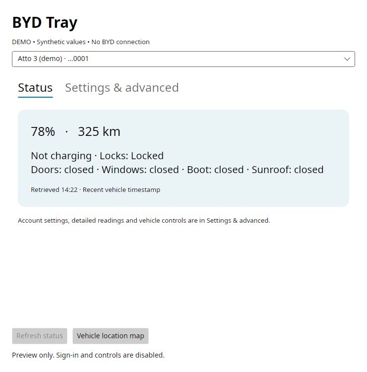

# BYD Tray

An unofficial desktop tray app for international BYD accounts, built with C# and Avalonia. See battery, charging, range and opening/lock status, request a vehicle location, and optionally use individually confirmed remote controls.

**Experimental; not affiliated with or endorsed by BYD.** Live evidence is limited to one Australian Atto 3. Other models, regions and advanced controls remain unverified. Windows 11 is a release target; see [actual validation](VALIDATION.md).



*Synthetic offline preview; no account or vehicle data is shown.*

## Windows 11

Choose the **win-x64.zip** archive on the [Releases page](https://github.com/craigchandler/byd-tray/releases). Release checksums are provided alongside the archives.

1. Extract the **entire** `BydTray-0.1.0-alpha.1-win-x64.zip` into a folder you can keep.
2. Open `Byd.Tray.exe`. Keep its supporting files in that folder.
3. Open **Settings & advanced → Account & startup**, select the account's registered country and sign in locally. Start with controls, startup sign-in and polling disabled, then refresh status once.

No Python, .NET installation, installer or administrator access is needed to run this self-contained build. The x64 build targets Intel/AMD Windows 11 PCs. ARM64 packaging is available to developers but has no native runtime evidence. Executables are currently unsigned; see [Windows setup and checks](docs/windows.md).

For a synthetic offline preview, run `./Byd.Tray.exe --demo` from PowerShell in the extracted folder. Demo cannot authenticate or operate a vehicle. Closing the window keeps the tray running; use **Open BYD Tray** to reopen it and **Quit** to exit. Windows may initially put the icon in notification-area overflow.

## KDE Plasma on Linux

Extract the whole Linux x64 archive and run `./Byd.Tray`; use `./Byd.Tray --demo` for an offline preview. The release includes .NET but needs KDE/KWallet and normal OS graphics/font libraries. KWallet 6 is required for optional account saving. Other distributions and Wayland/X11 combinations need separate runtime checks.

Startup integration is opt-in. See [usage](docs/usage.md#user-service-and-windows-startup) before installing or enabling a user service.

## Features and privacy

- **Status first:** battery, range, charging, locks/openings and freshness, plus one-line tray hover warnings.
- **Settings & advanced:** country selection, optional system-wallet saving/startup sign-in, manual advanced reads and capability-gated controls.
- **Location:** explicit GPS request; OpenStreetMap tiles load only after another click. No location history or background tracking.
- **Controls:** off at startup; every vehicle command needs a specific review and locally entered PIN. No automatic command retry. Disabling controls does not undo dispatched commands or vehicle-stored schedules.
- **Secrets:** KWallet on Linux and Windows Credential Manager on Windows; no plaintext fallback. PINs are never saved.

Signing in with the same account on another device can invalidate an existing session; see [using the phone app and tray together](#using-the-phone-app-and-tray-together). Status/location reads may wake the car. Optional polling is fifteen minutes and pauses after failure. Fresh profiles have saved-account use, automatic sign-in, polling and controls off. Unknown fields stay unknown.

Read [privacy](docs/privacy.md), [compatibility](docs/compatibility.md) and [usage](docs/usage.md). Never post credentials, PINs, tokens, VINs, precise locations or raw responses in issues.

## Using the phone app and tray together

A new sign-in with the same BYD account can invalidate the earlier session. BYD Tray signing in can therefore sign the phone app out, and another phone/app sign-in can invalidate the tray session. This behaviour was observed with the Australian Atto 3 used during development. BYD explicitly documents a one-account concurrent-device restriction in its [Indonesian app FAQ, question 7](https://www.byd.com/id/aftersales/byd-apps); that is a regional reference, not a verified universal device limit.

For multiple users/devices, BYD provides **Vehicle authorisation** to grant another account access to the same car. [BYD Europe's FAQ](https://www.byd.com/eu/service-maintenance/frequently-asked-questions) describes authorising other users, and [BYD NZ's FAQ](https://www.bydauto.co.nz/faq) confirms cloud-connected vehicle sharing with family or friends.

1. Keep the owner's account on the primary phone. In the official app, look for **Vehicle authorisation** and grant access to the other user's BYD account. Menu labels and available permissions vary by app version/market.
2. The other phone signs in with that authorised account's own email/password. Vehicle sharing does not transfer ownership or require sharing the owner's password.
3. A separate authorised account is also an option to test for the tray app, so it does not compete with the phone's login. Start with controls/polling off and one manual status read. Authorised-account compatibility and permissions have **not yet been live-verified with this tray app**; confirm them for your account and vehicle.

The tray does not silently sign in again after a session failure. This avoids a login loop that could repeatedly displace another device. Use the official app to manage authorisations and account security; BYD Tray does not create or grant accounts.

## Build and test

Requires .NET SDK 10. Python 3.10+ is a development/release tool only. The app consumes the pinned [Byd.Client 0.1.0-alpha.1 NuGet package](https://www.nuget.org/packages/Byd.Client/0.1.0-alpha.1); no sibling checkout is needed.

```sh
dotnet restore Byd.Tray.slnx --locked-mode
dotnet build Byd.Tray.slnx -c Release --no-restore
dotnet test Byd.Tray.slnx -c Release --no-build --no-restore
python -m unittest discover -s tests/release_checks -v
```

Windows: `scripts/package-release.ps1`. Linux: `./scripts/package-release.sh linux-x64`, or `./scripts/package-release.sh win-x64` to cross-build. Archives and SHA-256 sidecars appear under ignored `artifacts/releases/`. Packaging uses fresh staging, retains runtime/dependency licences and verifies the archive without starting the app. Cross-building is not Windows execution evidence.

[GitHub Actions](https://github.com/craigchandler/byd-tray/actions) restores, builds, runs offline headless tests and packages on Ubuntu/Windows. The Windows job also starts only the labelled demo and checks for a responding native window. No account or vehicle is needed. See the linked runs for results.

The manual release workflow validates an existing reviewed tag and optionally creates a protected GitHub **draft**. It never publishes automatically. See [release setup](docs/releasing.md), [contributing](CONTRIBUTING.md), [security reporting](SECURITY.md) and [changelog](CHANGELOG.md).

## Feedback

Report bugs and compatibility results through [GitHub Issues](https://github.com/craigchandler/byd-tray/issues). Include app version, OS, account country, vehicle model and a safe success/error description. Keep credentials and vehicle identifiers out of reports. Use [private security reporting](SECURITY.md) for suspected vulnerabilities.

## Licence and credits

Original app code uses the existing [MIT licence](LICENSE). [Byd.Client](https://github.com/craigchandler/byd-client-dotnet) retains protocol provenance and MIT notices for [jkaberg/pyBYD](https://github.com/jkaberg/pyBYD/tree/995ef70a2b6bd287d58c1f8564e6b50eabc7f868) and the country catalog. UI/map dependencies have separate licences, including BSD, MS-PL and Apache components; full texts and notices are bundled. See [third-party notices](THIRD-PARTY-NOTICES.md).
